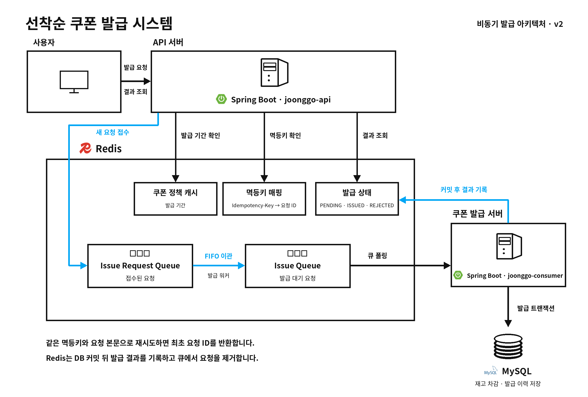
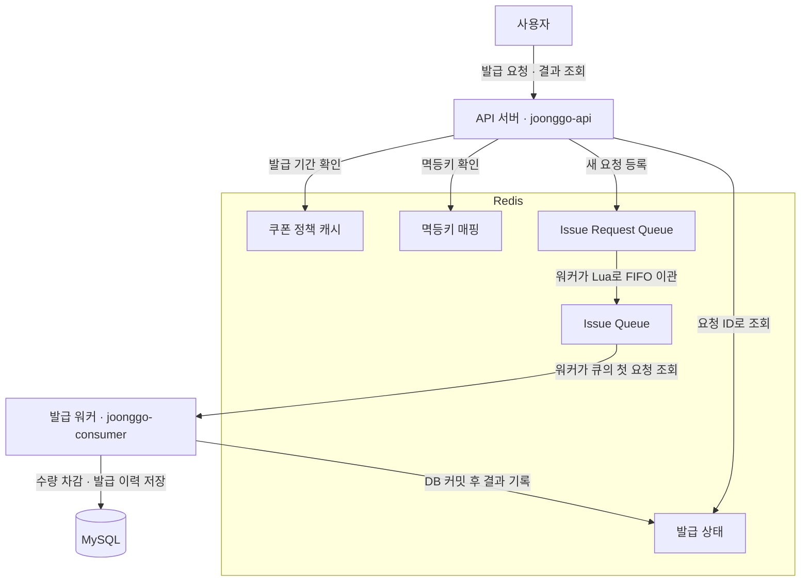

# 선착순 쿠폰 발급 시스템

쿠폰 발급 요청이 몰리면 API 서버는 접수 결과부터 돌려줍니다. 발급 워커는 Redis에 등록된 순서대로 요청을 처리합니다. 사용자는 요청 ID로 결과를 조회할 수 있습니다.

## 아키텍처



<details>
<summary>Mermaid 다이어그램 보기</summary>



</details>

쿠폰 정책이 캐시에 없으면 API 서버가 DB에서 발급 기간을 읽어 캐시에 저장합니다. API 서버는 접수 시각이 발급 기간 안에 든 요청만 큐에 등록합니다.

발급 워커는 쿠폰 행을 잠근 상태로 수량을 차감하고 발급 이력을 같은 트랜잭션에 저장합니다. DB에 일시적으로 장애가 나면 워커는 요청을 큐에 남겨 두고 다음 폴링에서 다시 처리합니다. DB 커밋 뒤 같은 요청이 다시 들어와도 발급 이력을 먼저 확인하므로 수량은 한 번만 차감됩니다.

## 모듈 구성

| 모듈 | 담당 기능 |
| --- | --- |
| `joonggo-api` | 쿠폰 발급 요청 접수, 정책 캐시, 결과 조회, HTTP 오류 응답 |
| `joonggo-consumer` | 큐 이관 및 폴링, 발급 트랜잭션 호출, 결과 기록 |
| `joonggo-core` | 쿠폰 도메인, Redis 큐, JPA 저장소, 발급 트랜잭션 |
| `joonggo-admin` | 관리자 애플리케이션 모듈 |

API 서버와 발급 워커는 각각 `joonggo-core`에 의존하며 별도 프로세스로 실행합니다.

## 발급 API

[쿠폰 API 인증 설정](docs/coupon-api-auth.md)을 참고하세요.

| 메서드와 경로 | 응답 |
| --- | --- |
| `POST /api/v2/coupon/issue` | `202 Accepted`, 요청 ID와 조회 URL |
| `GET /api/v2/coupon/issue/{requestId}` | `PENDING`, `ISSUED`, 또는 실패 코드와 함께 `REJECTED` |
| `POST /api/v1/coupon/issue` | 동기 발급 결과 |

v2는 요청 본문에서 `couponId`를 받고 토큰에서 회원 ID를 확인합니다. 완료 결과는 24시간 동안 조회할 수 있습니다. v2 요청은 FIFO 순서로 처리합니다. v1과 v2는 DB의 같은 쿠폰 재고를 사용합니다.

### 발급 요청 재시도

v2 POST에 `Idempotency-Key` 헤더를 보낼 수 있습니다. 처음 발급 요청을 보낼 때 UUID 같은 키를 하나 만들고, 같은 요청을 재시도할 때는 그 키를 그대로 보냅니다. 키는 영문자, 숫자, 점, 밑줄, 하이픈으로 최대 128자까지 쓸 수 있습니다.

| 재요청 | 응답 |
| --- | --- |
| 같은 키와 같은 `couponId`, `memberId` | 최초 접수와 같은 `202`, 요청 ID, 조회 URL |
| 같은 키와 다른 `couponId` 또는 `memberId` | `409 Conflict` |
| 새 키 또는 헤더 생략 | 새 요청 접수 |

처리 중에는 키가 유지되고, 발급 결과를 기록한 뒤에는 24시간 동안 같은 키를 재사용할 수 있습니다. 최신 발급 결과는 조회 URL에서 확인하세요.

기존 인스턴스를 교체할 때는 발급 워커를 먼저 업데이트하세요. 새 API는 멱등키가 들어온 요청에 키를 포함해 큐에 기록합니다.

## 로컬 실행

Java 17과 Docker Compose가 필요합니다. API 서버와 워커는 같은 Redis와 MySQL에 연결해야 합니다. `dev` 프로필의 기본 포트는 Redis `6380`, MySQL `3306`, API `8001`입니다. 발급 워커는 HTTP 포트를 열지 않습니다.

```bash
docker compose up -d redis mysql
bash gradlew :joonggo-api:bootRun --args='--spring.profiles.active=dev --spring.datasource.url=jdbc:mysql://localhost:3306/joonggo'
```

별도 터미널에서 발급 워커를 실행합니다.

```bash
bash gradlew :joonggo-consumer:bootRun --args='--spring.profiles.active=dev --spring.datasource.url=jdbc:mysql://localhost:3306/joonggo'
```

`dev` 프로필은 DB 테이블을 자동으로 만들지 않습니다. 실행 전에 MySQL 스키마를 준비하세요. 발급 요청에는 등록된 쿠폰과 회원 ID를 사용하세요.
